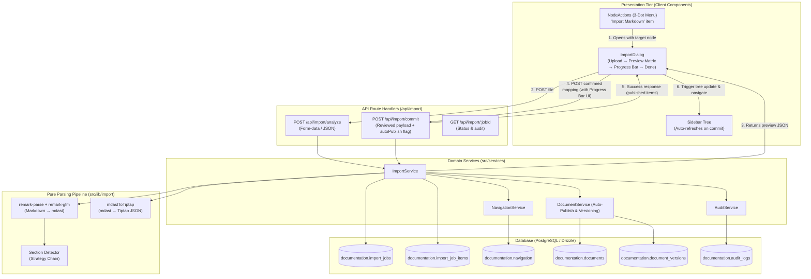
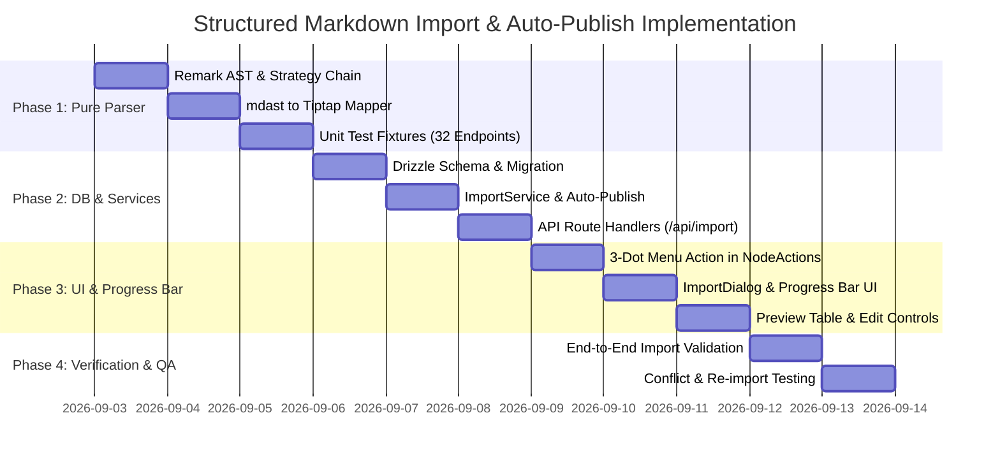

# Implementation Plan: Structured Markdown Auto-Import & Auto-Publish (3-Dot Action Integration)

**System:** Documentation Platform (Next.js 16 · PostgreSQL/`ltree` · Drizzle ORM · Tiptap v3)  
**Role:** Senior Software Engineer / Solutions Architect  
**Status:** Proposed & Ready for Implementation  
**Date:** 2026-09-02  

---

## 0. Executive Summary & Context

This implementation plan defines the architecture, data structures, parsing pipeline, and UI integration for **Structured Markdown Auto-Import, Auto-Publish, and Progress Tracking**.

### Key Adjustments & Architectural Constraints
1. **De-scoping Vercel Docs UI:** All Vercel-style UI layout/redesign tasks have been completely removed. The existing design system, reader/editor components, layout grid, and CSS color tokens (`globals.css`) remain 100% intact and unchanged.
2. **Contextual 3-Dot Menu Integration:** The import trigger is seamlessly integrated into the existing 3-dot dropdown menu (`NodeActions.tsx`) on navigation tree nodes. Clicking "Import Markdown" on a folder or document immediately sets that node as the target destination. An optional top-level import action is also accessible from the sidebar root header.
3. **Auto-Publish on Completion:** Upon completing the import, all created documents are **automatically published** (`status = 'PUBLISHED'`), stamping Version 1 in `document_versions` with initial published snapshots (`published_title`, `published_content`, `published_at`, `published_by`). Readers and editors can view the imported documentation immediately.
4. **Real-Time Progress Bar:** During the import process, an active visual progress bar with granular step and percentage updates (e.g. "Processing item 18 of 32: GET /campaign/view...") provides clear real-time feedback to the user.
5. **Zero Functionality Regression:** Works entirely within the platform's established 3-tier architecture (Presentation → API Route Handlers → Domain Services → Pure AST Pipeline → Drizzle DB).

---

## 1. Requirements

### 1.1 Functional Requirements (FR)

| ID | Requirement | Description |
|---|---|---|
| **FR-1** | **Contextual 3-Dot Trigger** | An `Import Markdown` action is available in the 3-dot menu (`NodeActions`) for any node (and root sidebar actions), opening a dedicated import dialog with the target parent pre-selected. |
| **FR-2** | **File Upload & Ingestion** | Editor/Admin can upload a `.md` / `.markdown` file (or paste markdown text) up to 10 MB. |
| **FR-3** | **Heuristic Section Detection** | Automatically detects repeating documented units (e.g. REST API endpoints like `### 3.1 GET /campaign/view - List All`) without hardcoded service names, generalizing to any service reference doc. |
| **FR-4** | **Automatic Tree Hierarchy** | Generates one parent **Folder** node (named after the H1 / source doc) and individual **Document** child nodes for each detected unit, preserving source order via fractional `sort_key`s. |
| **FR-5** | **Reference Section Preservation** | Non-catalog content (e.g. Overview, System Flow, Utilities) is detected as reference sections and imported as sibling docs in the same folder — zero content is silently discarded. |
| **FR-6** | **Interactive Human-in-the-Loop Preview** | Before committing, users see an interactive preview to rename titles, edit slugs, exclude unwanted sections, re-order, or change the target parent folder. |
| **FR-7** | **Auto-Publish on Completion** | All successfully imported documents are automatically created with `status = 'PUBLISHED'`, initial version history (Version 1) logged in `document_versions`, and immediately readable across reader/editor views. |
| **FR-8** | **High-Fidelity Tiptap Conversion** | Markdown elements (headings, code blocks with language syntax, tables, blockquotes, lists, marks) are converted into standard Tiptap JSON matching the platform's editor schema. |
| **FR-9** | **Live Import Progress Bar** | The modal displays an animated progress bar indicating active progress percentage, current stage, and document count (e.g., `Importing & publishing 12/32...`). |
| **FR-10** | **Auditability & Traceability** | Import batches are tracked in `import_jobs` and `import_job_items`, logging the actor, source file, strategy used, timestamp, and audit trail. |
| **FR-11** | **Re-Import & Conflict Detection** | Re-importing an updated markdown file calculates SHA-256 content hashes per section, proposing updates while flagging human-edited documents to avoid clobbering. |

### 1.2 Non-Functional Requirements (NFR)

| ID | Requirement | Description |
|---|---|---|
| **NFR-1** | **Performance** | Multi-thousand-line documents (e.g. 4,200+ lines / 30+ endpoints) parse and return a preview in `< 500ms`. Import and publishing batch completes within `< 3s`. |
| **NFR-2** | **Determinism** | Parsing is pure and 100% deterministic — same input AST always produces identical section splits and Tiptap JSON. |
| **NFR-3** | **RBAC Enforcement** | Restricted to `ADMIN` and `EDITOR` roles. Gated both in the UI and verified in `ImportService`. |
| **NFR-4** | **Zero UI/Style Regression** | Reuses existing Tailwind tokens, Radix dialog primitives, and Sonner toasts. Zero edits to `globals.css` color variables. |
| **NFR-5** | **Transactional Integrity** | Tree insertion and document publishing execute inside a single atomic database transaction; if any error occurs, the entire batch rolls back cleanly. |

---

## 2. System Architecture

### 2.1 Component Tier Diagram



---

## 3. Detailed Component & Pipeline Specifications

### 3.1 UI Trigger: 3-Dot Menu Integration (`NodeActions.tsx`)

In `src/components/navigation/NodeActions.tsx`, add an "Import Markdown" entry to the `DropdownMenuContent`:

```tsx
// Inside NodeActions.tsx
{canEdit && (
  <>
    <DropdownMenuItem onClick={() => onAction.onImport(node)}>
      <UploadCloud className="size-3.5" />
      Import Markdown
    </DropdownMenuItem>
    {/* Existing items: Add child, Rename, Duplicate, Publish, Hide, Delete */}
  </>
)}
```

#### Callback Flow:
1. When clicked, `onAction.onImport(node)` sets `importTargetNode` state in `Sidebar.tsx`.
2. `ImportDialog` opens, showing the destination folder (or root) and allowing the user to select or drag-and-drop a `.md` file.

---

### 3.2 Modal Flow & Progress Bar: `ImportDialog` (`src/components/navigation/ImportDialog.tsx`)

The dialog operates in a 3-step state machine with interactive progress indicators:

```
[ Step 1: Upload ]  --->  [ Step 2: Interactive Preview ]  --->  [ Step 3: Progress & Auto-Publish ]
```

#### Step 1: Upload
- Dropzone for `.md` or `.markdown` files.
- Displays target location indicator: *"Importing inside: [Folder Title]"* or *"Importing at Top Level"*.
- Option to specify whether to wrap in a new parent folder or import directly under target.

#### Step 2: Interactive Preview Matrix
Displays the analyzed split from `POST /api/import/analyze`:
- **Folder Name**: Editable input for the container folder.
- **Section Table**:
  - Checkbox: Include / Exclude item.
  - HTTP Method Badge: `GET` (blue), `POST` (green), `PUT`/`PATCH` (amber), `DELETE` (red), or `DOC` (slate).
  - Title: Editable inline.
  - Slug: Auto-generated from title, editable.
  - Section Type: `Catalog Unit` (e.g. endpoint) vs `Reference Document` (e.g. Overview).
  - Content Summary: Word count, table count, code block indicators.
- **Auto-Publish Checkbox**: Checked by default (`"Auto-publish imported documents immediately"`).
- Actions: `Select All`, `Deselect All`, `Back`, `Confirm & Import`.

#### Step 3: Active Progress Bar & Completion
- When user clicks **Confirm & Import**, step 3 displays:
  - Accessible `<Progress value={progressPercent} className="h-2.5 w-full" />` component.
  - Active step tracker: *"Step 1/3: Converting AST to Tiptap..."* $\rightarrow$ *"Step 2/3: Creating tree nodes & auto-publishing 32 documents..."* $\rightarrow$ *"Step 3/3: Finalizing audit log..."*.
  - Item counter with animation: `Importing item 19 of 32: GET /campaign/view...`.
- On completion: Closes dialog, shows success toast (`"Imported and published 32 documents successfully"`), updates sidebar navigation tree, and routes user to the newly created folder / first published document.

---

### 3.3 Pure Parsing Sub-Pipeline (`src/lib/import/`)

Located in `src/lib/import/`, this pipeline has **zero database dependencies** and is 100% unit-testable.

```
src/lib/import/
├── parser.ts            # Unified / Remark AST parser
├── strategies/
│   ├── types.ts         # Strategy interfaces & DetectedSection types
│   ├── pattern-heading.ts   # Matches REST method/path patterns
│   ├── numbered-heading.ts  # Matches repeating numbered catalog depths
│   └── single-document.ts   # Fallback for unstructured docs
├── detector.ts          # Strategy chain orchestrator
└── mapper.ts            # Pure mdast → Tiptap JSON node transformer
```

#### Strategy 1: `PatternHeadingStrategy` (Primary)
Detects catalog headings adhering to API documentation standards:
```regex
^#{2,4}\s+([\d.]+\.?\s*)?`?(GET|POST|PUT|PATCH|DELETE|HEAD|OPTIONS)\s+([^\s`]+)`?\s*(?:[—-]\s*(.+))?$
```
- Extracts: `method`, `route`, `cleanTitle`, `headingDepth`.
- Collects all subsequent markdown nodes until the next matching heading.

#### Strategy 2: `NumberedSubsectionStrategy` (Generic Fallback)
For non-API docs (e.g. architecture specifications, user manuals):
- Identifies repeating heading levels (`## 1.`, `## 2.` or `### 3.1`, `### 3.2`) that appear $\ge 3$ times.
- Splits content by subsection boundaries.

#### Strategy 3: `SingleDocumentFallback`
- When no repeating structure is identified, imports the file as a single coherent document without splitting.

#### Reference Section Extraction:
- Headings preceding the catalog (e.g. `## 1. Overview`, `## 2. Architecture`) or trailing it (e.g. `## 5. Utilities`, `## 6. System Flow`) are captured as `type: "REFERENCE"`.
- Proposed as sibling documents inside the parent folder.

---

### 3.4 AST to Tiptap JSON Mapper (`src/lib/import/mapper.ts`)

Directly converts standard `mdast` nodes into Tiptap-compliant JSON compatible with `buildEditorExtensions()`:

| Markdown / mdast Node | Tiptap JSON Node | Attributes / Notes |
|---|---|---|
| `heading` (depth $N$) | `{"type": "heading", "attrs": {"level": N}}` | Levels 1–6 preserved. |
| `paragraph` | `{"type": "paragraph"}` | Contains text and inline marks. |
| `code` (fenced block) | `{"type": "codeBlock", "attrs": {"language": lang}}` | Feeds into `lowlight` syntax highlighting. |
| `table`, `tableRow`, `tableCell` | `{"type": "table"}`, `tableRow`, `tableCell` / `tableHeader` | Native Tiptap table structure. |
| `list` (ordered / unordered) | `{"type": "orderedList"}` / `{"type": "bulletList"}` | Encapsulates `listItem` nodes. |
| `blockquote` | `{"type": "blockquote"}` | Standard blockquote formatting. |
| `thematicBreak` | `{"type": "horizontalRule"}` | `<hr>` divider. |
| `strong` | `{"type": "text", "marks": [{"type": "bold"}]}` | Bold text. |
| `emphasis` | `{"type": "text", "marks": [{"type": "italic"}]}` | Italic text. |
| `inlineCode` | `{"type": "text", "marks": [{"type": "code"}]}` | Inline monospace code. |
| `link` | `{"type": "text", "marks": [{"type": "link", "attrs": {"href": url}}]}` | Hyperlinks. |

---

## 4. Database Schema Additions

Add the import job tracking tables to `src/db/schema.ts` within the `documentation` schema:

```typescript
// src/db/schema.ts

export const importStatusEnum = pgEnum("import_status", [
  "ANALYZED",
  "COMMITTED",
  "FAILED",
]);

export const importJobs = documentation.table(
  "import_jobs",
  {
    id: uuid("id").primaryKey().defaultRandom(),
    sourceFilename: text("source_filename").notNull(),
    status: importStatusEnum("status").notNull().default("ANALYZED"),
    strategyUsed: text("strategy_used").notNull(),
    rawMarkdown: text("raw_markdown").notNull(),
    parentNavigationId: uuid("parent_navigation_id").references(() => navigation.id, {
      onDelete: "set null",
    }),
    targetFolderId: uuid("target_folder_id").references(() => navigation.id, {
      onDelete: "set null",
    }),
    totalSections: integer("total_sections").notNull().default(0),
    importedSections: integer("imported_sections").notNull().default(0),
    autoPublished: boolean("auto_published").notNull().default(true),
    warnings: jsonb("warnings").$type<string[]>().default([]),
    createdBy: uuid("created_by")
      .notNull()
      .references(() => users.id),
    createdAt: timestamp("created_at", { withTimezone: true, mode: "date" })
      .notNull()
      .defaultNow(),
    committedAt: timestamp("committed_at", { withTimezone: true, mode: "date" }),
  },
  (table) => [
    index("import_jobs_created_by_idx").on(table.createdBy),
    index("import_jobs_created_at_idx").on(table.createdAt),
  ]
);

export const importJobItems = documentation.table(
  "import_job_items",
  {
    id: uuid("id").primaryKey().defaultRandom(),
    importJobId: uuid("import_job_id")
      .notNull()
      .references(() => importJobs.id, { onDelete: "cascade" }),
    documentId: uuid("document_id").references(() => documents.id, {
      onDelete: "set null",
    }),
    navigationId: uuid("navigation_id").references(() => navigation.id, {
      onDelete: "set null",
    }),
    sectionTitle: text("section_title").notNull(),
    sectionSlug: text("section_slug").notNull(),
    sectionHash: text("section_hash").notNull(), // SHA-256 for re-import diffing
    orderIndex: integer("order_index").notNull(),
    status: text("status").notNull().default("SUCCESS"),
  },
  (table) => [
    index("import_job_items_job_id_idx").on(table.importJobId),
    index("import_job_items_hash_idx").on(table.sectionHash),
  ]
);
```

---

## 5. API Route Handlers

### 5.1 `POST /api/import/analyze`
- **Authentication:** Session with `ADMIN` or `EDITOR` role.
- **Input:** `multipart/form-data` with `.md` file OR JSON `{ rawMarkdown: string, filename: string, parentId?: string | null }`.
- **Processing:**
  1. Runs `remark-parse` + `remark-gfm` to generate AST.
  2. Executes strategy chain (`PatternHeadingStrategy` → `NumberedSubsectionStrategy` → `SingleDocumentFallback`).
  3. Returns detected sections, proposed folder name, slug hints, and content metrics.
- **Output:** Preview payload including sections list, suggested folder title/slug, and strategy metadata.

---

### 5.2 `POST /api/import/commit`
- **Authentication:** Session with `ADMIN` or `EDITOR` role.
- **Input:**
  ```json
  {
    "sourceFilename": "Campaign-Service-Documentation.md",
    "rawMarkdown": "...",
    "strategyUsed": "PatternHeadingStrategy",
    "parentId": "uuid-or-null",
    "createFolder": true,
    "folderTitle": "Campaign Service",
    "folderSlug": "campaign-service",
    "autoPublish": true,
    "items": [
      {
        "title": "GET /campaign/campaign-type — Get Campaign Types",
        "slug": "get-campaign-campaign-type",
        "rawMarkdown": "...",
        "orderIndex": 0,
        "include": true
      }
    ]
  }
  ```
- **Processing (Transactional in `ImportService`):**
  1. Creates target Folder node under `parentId` if `createFolder` is true (using `NavigationService.createNode`).
  2. For each included item:
     - Maps section Markdown to Tiptap JSON via `mdastToTiptap`.
     - Creates Document row with `status = autoPublish ? 'PUBLISHED' : 'DRAFT'`.
     - If `autoPublish` is true, stamps `published_title`, `published_content`, `published_at`, `published_by`, `current_version = 1`, and inserts initial row into `document_versions`.
     - Creates Navigation node of type `DOCUMENT` with fractional `sort_key` under the folder.
  3. Inserts `import_jobs` and `import_job_items` records with SHA-256 content hashes.
  4. Records `AuditService` log (`action: "IMPORT_MARKDOWN"`).
- **Output:**
  ```json
  {
    "success": true,
    "data": {
      "jobId": "uuid",
      "folderId": "uuid",
      "createdCount": 33,
      "autoPublished": true,
      "firstDocumentSlugPath": "campaign-service/get-campaign-campaign-type"
    }
  }
  ```

---

## 6. Architecture Decision Records (ADR)

### ADR-1: Contextual 3-Dot Menu Trigger over Separate Dedicated Import Page
- **Context:** Where should the user access the import feature?
- **Decision:** Place the "Import Markdown" action directly in the node's 3-dot dropdown menu (`NodeActions.tsx`) as well as in the top-level sidebar actions.
- **Rationale:** Contextual actions provide superior UX because the target parent folder is automatically known from the node where the user clicked. A modal dialog keeps the user within their current working context without navigating away or losing sidebar state.

### ADR-2: Deterministic Heuristic Chain over LLM-Only Parser
- **Context:** Need reliable, rapid splitting across varying documentation styles.
- **Decision:** Use an ordered chain of deterministic AST heuristics (`PatternHeadingStrategy` → `NumberedSubsectionStrategy` → `SingleDocumentFallback`).
- **Rationale:** Deterministic parsing is instantaneous, zero-cost, runs offline/locally without external API keys, and is 100% testable via standard unit tests.

### ADR-3: Pure `mdast → Tiptap JSON` Mapper over Headless Editor
- **Context:** Converting Markdown to Tiptap JSON format server-side.
- **Decision:** Implement a pure transformation function mapping `mdast` AST directly to Tiptap JSON node structures.
- **Rationale:** Avoids heavy DOM/JSDOM dependencies or headless browser instantiation in Next.js Server Actions / Route Handlers, ensuring fast and robust conversion.

### ADR-4: Auto-Publishing by Default with Version 1 Audit
- **Context:** Should imported documents require a manual second publish pass, or be published immediately upon completion?
- **Decision:** Automatically publish all imported documents upon import completion, creating initial Version 1 records in `document_versions`.
- **Rationale:** Reduces friction for bulk imports (such as importing an entire service documentation with 30+ endpoints) while maintaining complete version history and auditability.

---

## 7. Implementation Roadmap & Phases



### Phase 1: Pure Parsing Pipeline & Unit Tests
- Add `remark-parse` and `remark-gfm` dependencies.
- Build `src/lib/import/strategies/` and `src/lib/import/mapper.ts`.
- Create unit test fixtures using `Campaign-Service-Documentation.md` verifying all 32 endpoints and reference sections parse accurately.

### Phase 2: Database Layer & Domain Service
- Add `importJobs` and `importJobItems` tables to `src/db/schema.ts`.
- Run Drizzle migration.
- Implement `ImportService` in `src/services/import.service.ts` with atomic batch creation and auto-publishing via `createDocument(actor, { status: "PUBLISHED" })`.
- Implement API Route Handlers: `/api/import/analyze` and `/api/import/commit`.

### Phase 3: UI Integration (3-Dot Menu, Modal & Progress Bar)
- Update `src/components/navigation/NodeActions.tsx` to include `Import Markdown`.
- Build `src/components/ui/progress.tsx` (accessible progress bar).
- Build `src/components/navigation/ImportDialog.tsx` with upload dropzone, interactive preview table, and animated real-time progress bar.
- Wire mutation and toast feedback into `Sidebar.tsx`.

### Phase 4: End-to-End Verification & Polish
- Validate import of large files (e.g. 4,200+ line campaign doc).
- Verify document navigation, Tiptap rendering, table display, code syntax highlighting, auto-published status, and version history for imported docs.
- Test RBAC enforcement and error boundary handling.

---

## 8. Verification & QA Plan

### 8.1 Automated Test Suites
- **Unit Tests (`src/lib/import/__tests__/`):**
  - Test `PatternHeadingStrategy` against varied REST endpoint heading styles.
  - Test `NumberedSubsectionStrategy` on standard numbered markdown documents.
  - Test `mdastToTiptap` against tables, code fences with languages, nested lists, and marks.
- **Service Integration Tests:**
  - Verify `ImportService.commit` correctly creates parent folders, child documents, `ltree` paths, initial `document_versions` rows (Version 1), and audit entries in a single transaction.

### 8.2 Manual Verification Steps
1. **Trigger via 3-Dot Menu:** Hover over a folder in the sidebar, click the 3-dot icon (`MoreHorizontal`), and click **Import Markdown**. Confirm dialog opens with that folder as target.
2. **Preview Verification:** Upload `Campaign-Service-Documentation.md`. Verify preview displays 32 endpoint documents + 3 reference documents (Overview, Utilities, Overall System Flow).
3. **Customization in Preview:** Deselect one endpoint, rename another, change slug, verify auto-publish toggle is enabled.
4. **Progress Bar & Commit:** Click **Confirm & Import**. Verify that:
   - Animated progress bar displays progress percentages and active document counters.
   - Folder and child documents appear in the sidebar tree instantly.
   - All documents are created with `PUBLISHED` status and version 1 history.
   - Clicking an imported document renders all tables, code snippets, and headings cleanly in reader mode without requiring manual publish.
5. **RBAC Check:** Log in as `VIEWER` and verify the import option is not visible or accessible.
