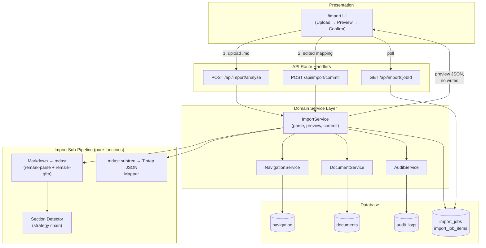
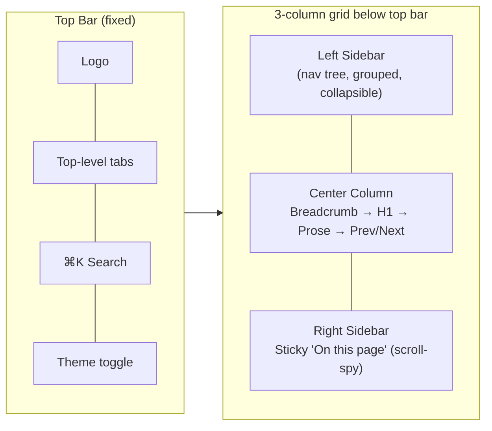

# Implementation Plan: Structured Markdown Auto-Import & Vercel-Style Docs UI

**System:** Documentation Platform (Next.js 16 · PostgreSQL/`ltree` · Drizzle · Tiptap v3)
**Author:** Architecture Design Session
**Status:** Proposed
**Date:** 2026-09-01

---

## 0. Context

This plan extends the existing platform (see `system_documentation.md`) with two features, informed by the real-world shape of `Campaign-Service-Documentation.md`:

1. **Markdown Auto-Import & Split** — upload a single large `.md` file (e.g. a service's API reference) and have the system automatically detect each individually-documented unit (in the sample file, each REST endpoint) and create one navigation node + one document per unit, named after that unit.
2. **Vercel-Docs-style Frontend Template** — restructure the reading/browsing experience (3-column docs layout, breadcrumbs, prev/next, sticky TOC, refined code blocks) **without changing any existing color tokens**.

The sample file confirms the pattern the parser must key off:

```text
### 3.1. `GET /campaign/campaign-type` — Get Campaign Types
### 3.2. `POST /campaign/create` — Create Campaign
### 3.3. `GET /campaign/view/:id` — Get Single Campaign
...
```

32 such headings exist in the sample, each followed by a consistent sub-structure (`#### 1. API Information`, `#### 2. Request Payload`, etc.) until the next `### 3.N` heading or a new `## ` section (`5. Utilities`, `6. Overall System Flow`).

---

## 1. Requirements

### 1.1 Functional Requirements — Feature A (Import)

| # | Requirement |
|---|---|
| FR-1 | Editor/Admin can upload a `.md` file as the import source. |
| FR-2 | System detects individually-documented units inside the file (endpoints in this case) without hardcoding "campaign manager" specifics — must generalize to any service doc following a similar heading convention. |
| FR-3 | Each detected unit becomes its **own Document + Navigation node**, titled after the unit (e.g. `GET /campaign/campaign-type — Get Campaign Types`). |
| FR-4 | All generated documents are nested under one parent **Folder** node named after the source doc (e.g. `Campaign Service`), preserving the source's own ordering. |
| FR-5 | Content not matching the "unit" pattern (System Overview, Utilities, Overall System Flow, etc.) is still imported, either as sibling reference documents or flagged for manual placement — nothing is silently dropped. |
| FR-6 | Before anything is written to the database, the user sees a **preview** of the proposed split (titles, slugs, parent folder) and can rename, exclude, merge, or re-parent entries. |
| FR-7 | Committing an import creates documents in **DRAFT** status only — nothing is auto-published, consistent with the platform's draft/publish model. |
| FR-8 | Markdown content of each unit (tables, code fences, nested lists) is converted into valid Tiptap JSON, not dumped as a single raw text/code block. |
| FR-9 | The import is fully audited (`AuditService`) and traceable back to the source file and batch. |
| FR-10 | Re-importing the same file (e.g. after the source doc is updated) is a supported, non-destructive operation — it must not silently duplicate or clobber human edits made after the first import. |

### 1.2 Non-Functional Requirements — Feature A

| # | Requirement |
|---|---|
| NFR-1 | Must handle large files (the sample is ~4,200 lines / ~32 endpoints) in a single request without timing out. |
| NFR-2 | Parsing must be deterministic and unit-testable — same input always yields the same proposed split. |
| NFR-3 | Import is gated by existing RBAC (`EDITOR`/`ADMIN` only), enforced in the service layer per the platform's existing pattern. |
| NFR-4 | Failure of one unit's conversion must not fail the whole batch — partial success with a clear report. |

### 1.3 Requirements — Feature B (Vercel-style UI)

| # | Requirement |
|---|---|
| FR-11 | Adopt the Vercel-docs layout language: fixed top bar, left nav sidebar, center prose column, sticky right-hand "On this page," breadcrumbs, prev/next footer navigation, refined code blocks with copy affordance. |
| FR-12 | **Zero changes to existing color tokens** (`globals.css` CSS variables driving `next-themes` light/dark mode) — this is a layout/typography/spacing change, not a re-theme. |
| FR-13 | Must not regress existing functionality: drag-and-drop tree reorder, bubble/slash menus, search command palette, version history modal. |
| FR-14 | Responsive: sidebars collapse to drawers on mobile/tablet, matching Vercel's behavior. |

---

## 2. Feature A — Import Architecture

### 2.1 Where it sits in the existing 3-tier architecture



### 2.2 Section Detection: strategy chain

The detector must generalize beyond the Campaign doc, so it runs a small chain of strategies in order and uses the first one that yields a confident split:

1. **`PatternHeadingStrategy` (primary, matches the sample file)**
   Looks for a **consistent heading template** at a single depth within a designated "catalog" section, e.g.:
   ```
   ^#{2,4}\s+[\d.]+\.?\s*`?(GET|POST|PUT|PATCH|DELETE)\s+([^\s`]+)`?\s*[—-]\s*(.+)$
   ```
   Captures **method**, **route**, **title**. This is not campaign-specific — it fires on *any* Markdown doc that documents REST endpoints this way (it would equally split an Orders Service or Auth Service doc).

2. **`NumberedSubsectionStrategy` (secondary generic fallback)**
   If no method/route pattern is found, splits on the heading depth that (a) appears ≥3 times and (b) whose sections are of comparable size — i.e., "whatever repeating heading level looks like a catalog of items." Titles become the heading text verbatim (e.g., useful for docs about "modules," "commands," or "resources" instead of endpoints).

3. **`SingleDocumentFallback`**
   If nothing repeats in a catalog-like way, the whole file is imported as one document (no split), and the UI tells the user why (“no repeating structure detected”).

Each strategy returns a normalized `DetectedSection[]`:

```ts
interface DetectedSection {
  title: string;          // "GET /campaign/campaign-type — Get Campaign Types"
  slugHint: string;        // "get-campaign-campaign-type"
  method?: string;          // "GET"
  route?: string;           // "/campaign/campaign-type"
  headingDepth: number;
  startLine: number;
  endLine: number;
  mdastNode: Root;          // the section's own subtree, ready for conversion
  orderIndex: number;
}
```

Non-catalog content (`## 1. System Overview`, `## 5. Utilities`, `## 6. Overall System Flow` in the sample) is captured separately as **"reference" sections** — proposed as sibling documents in the same folder (e.g. `Campaign Service / Overview`, `Campaign Service / Utilities`) rather than discarded, satisfying FR-5.

### 2.3 Markdown → Tiptap JSON conversion

**Decision:** convert via a deterministic `mdast → Tiptap JSON` mapper rather than instantiating a headless editor.

- Parse with `remark-parse` + `remark-gfm` (tables, strikethrough) → standard `mdast`.
- Walk the tree once; map node-for-node onto the platform's existing Tiptap schema, since StarterKit's node names already mirror CommonMark:
  - `heading` → `heading` (`attrs.level`)
  - `paragraph` → `paragraph`
  - `list` / `listItem` → `bulletList`/`orderedList` + `listItem`
  - `code` (fenced) → `codeBlock` with `attrs.language` (feeds directly into the existing `CodeBlockLowlight` + `lowlight` highlighting)
  - `table`/`tableRow`/`tableCell` → the platform's existing `Table`/`TableRow`/`TableCell`/`TableHeader` extensions
  - `blockquote` → `blockquote`
  - `thematicBreak` → `horizontalRule`
  - inline `strong`/`emphasis`/`inlineCode`/`link` → Tiptap marks
- Nodes with no Tiptap equivalent (e.g. the doc's ASCII-art flow diagrams inside plain code fences) degrade gracefully to a plain `codeBlock` — never silently dropped, always flagged in the import report as "rendered as code block; review formatting."
- The platform's **custom** nodes (Callout, API Block/Tabs) are *not* inferred from plain Markdown on import — that's a deliberate non-goal (see ADR-3). Editors can upgrade a plain code block to a Callout/API Block manually post-import.

### 2.4 Data model additions

```sql
CREATE TABLE documentation.import_jobs (
  id UUID PRIMARY KEY DEFAULT gen_random_uuid(),
  source_filename TEXT NOT NULL,
  status TEXT NOT NULL CHECK (status IN ('PARSED','COMMITTED','FAILED')),
  strategy_used TEXT NOT NULL,           -- e.g. 'PatternHeadingStrategy'
  raw_markdown TEXT NOT NULL,            -- full source, for audit + re-import diffing
  parent_navigation_id UUID REFERENCES documentation.navigation(id),
  warnings JSONB DEFAULT '[]',
  created_by UUID NOT NULL REFERENCES documentation.users(id),
  created_at TIMESTAMPTZ DEFAULT now(),
  committed_at TIMESTAMPTZ
);

CREATE TABLE documentation.import_job_items (
  id UUID PRIMARY KEY DEFAULT gen_random_uuid(),
  import_job_id UUID NOT NULL REFERENCES documentation.import_jobs(id) ON DELETE CASCADE,
  document_id UUID REFERENCES documentation.documents(id),
  navigation_id UUID REFERENCES documentation.navigation(id),
  section_title TEXT NOT NULL,
  section_hash TEXT NOT NULL,            -- content hash, used for re-import diffing
  order_index INT NOT NULL
);
```

No changes are required to `navigation` or `documents` — imported items are ordinary rows (Folder + Document nodes, `status = 'DRAFT'`), which means every existing feature (versioning, publishing, RBAC, trash, search) works on imported content for free.

### 2.5 Re-import behavior (FR-10)

On a second import of the same source file:
- Match new `DetectedSection`s to existing `import_job_items` by `route`+`method` (or title, if no route) from the prior job.
- Compare `section_hash`: unchanged → skip; changed → propose an **update to the existing document's draft** (never overwrites a human-edited draft silently — if the draft differs from the last imported hash, the diff is surfaced in the preview as a **conflict**, same UX pattern the platform already uses for autosave conflicts).
- New sections not seen before → proposed as new documents, same as first import.
- Sections no longer present in the source → flagged, not auto-deleted (soft-delete requires explicit confirmation).

### 2.6 API surface

| Method | Route | Purpose |
|---|---|---|
| `POST` | `/api/import/analyze` | Upload `.md`, run parse + detection, return preview (no DB writes). |
| `POST` | `/api/import/commit` | Persist an (optionally edited) preview: creates Folder + Document + Navigation rows, audit entries. |
| `GET` | `/api/import/:jobId` | Fetch job status/result, for polling large imports. |
| `GET` | `/api/import` | List past import jobs (admin visibility). |

### 2.7 Example: sample file → resulting tree

```
Campaign Service/                        ← Folder (from H1 title)
├── Overview                             ← reference section (## 1)
├── GET /campaign/campaign-type — Get Campaign Types
├── POST /campaign/create — Create Campaign
├── GET /campaign/view/:id — Get Single Campaign
├── GET /campaign/view — List All Campaigns
├── PATCH /campaign/update — Update Campaign
│  ...  (all 32 endpoints, in source order via fractional sort_key)
├── Utilities                            ← reference section (## 5)
└── Overall System Flow                  ← reference section (## 6)
```

---

## 3. Feature B — Vercel-Docs-Style Frontend (colors unchanged)

### 3.1 Principle

Everything Vercel's docs UI is admired for is **layout, density, and typographic rhythm** — not its palette. So this is scoped as a **layout/composition refactor**:

- `globals.css` CSS variables (`--background`, `--foreground`, `--primary`, `--border`, `--muted`, etc.) are **not touched**.
- All new/changed components consume the *existing* Tailwind/shadcn tokens exclusively (`bg-background`, `text-foreground`, `border-border`, `bg-muted`, etc.) — no hardcoded hex values introduced.
- Dark/light mode via `next-themes` continues to work unchanged, since only structure/spacing/typography classes change.

### 3.2 Target layout



### 3.3 Component-level changes

| Component | Change |
|---|---|
| `AppShell` | Restructure to CSS grid: `grid-cols-[260px_1fr_240px]` on `xl+`, collapsing to `[260px_1fr]` on `lg`, single column with drawers below `lg`. Top bar becomes fixed/sticky, matching Vercel's persistent header. |
| `Sidebar` | Group nodes visually (uppercase, muted-foreground section labels); active item gets `border-l-2 border-primary bg-muted/60`; keep existing `@dnd-kit` reorder logic untouched — only restyled, not re-architected. |
| `DocumentViewer` | Add **Breadcrumb** (derived from the existing `ltree` ancestor query — `path @> …` already documented in §5 of the system doc, no new query needed) above the title. Add **Prev/Next footer** computed from sibling `sort_key` order (reuses the existing fallback-navigation logic in `src/lib/tree/fallback.ts`). |
| `OnThisPage` | Make sticky (`sticky top-[var(--topbar-h)]`), add IntersectionObserver-based scroll-spy to highlight the active heading — purely additive to the existing component. |
| Editor/Viewer prose styles | Tighten heading scale and line-height, adopt Vercel-like inline-code pill style (`bg-muted px-1.5 py-0.5 rounded text-sm`) — all via existing `--muted`/`--foreground` tokens. |
| Code blocks | Add a copy-to-clipboard button and (optional) language tab bar for multi-snippet blocks; background/border still driven by existing `--muted`/`--border` tokens, so it re-skins automatically in dark mode. |
| `SearchCommand` | Visual polish only (Vercel-style ⌘K trigger pill in the top bar) — underlying full-text search endpoint is unchanged. |

### 3.4 Explicitly out of scope

- No new color palette, no new font import unless separately requested (keeps risk low and satisfies "colors of the existing system will be same" literally).
- No change to the RBAC-gated edit/publish/version UI beyond what's needed to fit the new grid.

---

## 4. Architecture Decision Records

### ADR-1: Heuristic Section Detection over Manual/AI-only Splitting

**Status:** Accepted

**Context:** The import must generalize across differently-structured service docs while still perfectly handling the common "catalog of endpoints" shape demonstrated by the Campaign Service doc.

**Decision:** Use a small ordered chain of deterministic, testable heuristics (`PatternHeadingStrategy` → `NumberedSubsectionStrategy` → `SingleDocumentFallback`), always followed by a **human preview/confirm step** before any write.

**Alternatives Considered**
- **Pure LLM-based semantic splitting** — flexible, but non-deterministic, harder to unit test, adds an external dependency/cost/latency to every import, and is overkill for the highly regular structure actually observed in the sample file.
- **Fully manual splitting (no auto-detection)** — safest but defeats the actual ask ("automatically separate the individual parts").

**Consequences**
- Positive: deterministic, fast, no external API dependency, fully unit-testable against fixture files (including the two uploaded docs).
- Negative: won't perfectly auto-detect completely novel, irregular structures on the first try — mitigated by the fallback strategy + mandatory preview/edit step.

**Trade-offs:** Predictability and testability are prioritized over "magic" auto-detection of arbitrary document shapes.

---

### ADR-2: Preview-Then-Commit Two-Phase Import (Human-in-the-Loop)

**Status:** Accepted

**Context:** Auto-split heuristics can misfire on edge cases (irregular headings, one-off sections). Writing directly to `navigation`/`documents` on upload risks polluting the tree with bad splits.

**Decision:** `POST /api/import/analyze` never writes to the database; it returns a preview only. A separate, explicit `POST /api/import/commit` performs the writes, using the (optionally user-edited) mapping.

**Consequences**
- Positive: matches the platform's existing draft-safety philosophy (§6.1 of the system doc); zero risk of bad imports polluting the live nav tree; users can rename/exclude/merge sections before anything is persisted.
- Negative: one extra round trip / UI step versus a single-click import.

**Trade-offs:** Safety and correctness over minimum click-count.

---

### ADR-3: Deterministic mdast→Tiptap Mapper over Headless-Editor Conversion

**Status:** Accepted

**Context:** Need to turn each detected Markdown section into valid Tiptap JSON server-side.

**Decision:** Implement a pure `mdast → Tiptap JSON` mapping function (via `remark-parse`/`remark-gfm`) rather than booting a headless ProseMirror/Tiptap editor instance on the server.

**Alternatives Considered**
- **Headless editor instance (e.g. `tiptap-markdown` extension) run server-side** — reuses Tiptap's own parser, but requires a DOM-ish environment / more moving parts inside a Next.js Route Handler, and is harder to unit test in isolation.

**Consequences**
- Positive: pure function, trivially unit-tested with fixture Markdown → expected JSON pairs; no server-side editor bootstrapping; fits the platform's "business logic encapsulated in domain services" principle.
- Negative: custom nodes (Callout, API Block/Tabs) cannot be inferred from plain Markdown — they degrade to plain code/quote blocks and must be manually upgraded post-import. Documented as a known limitation, not a blocker.

---

### ADR-4: Preserve Theme Tokens; Vercel-Docs Adoption is Layout-Only

**Status:** Accepted

**Context:** The user wants Vercel's documentation *layout* while explicitly keeping the current color scheme.

**Decision:** All Vercel-docs-inspired UI work is scoped to layout (CSS grid), spacing, typography scale, and component composition. No edits to `globals.css` color custom properties; every new/changed class uses existing semantic Tailwind tokens (`bg-background`, `text-muted-foreground`, `border-border`, etc.), never hardcoded colors.

**Consequences**
- Positive: zero risk of visual regression to branding/theme; dark/light mode continues to work automatically; change is reviewable as a pure structural diff.
- Negative: the result won't be a pixel-identical clone of vercel.com/docs (which has its own palette) — it will match its *structure and rhythm*, using this platform's own colors, which is exactly what was requested.

---

### ADR-5: Imports Always Land as DRAFT, Never Auto-Published

**Status:** Accepted

**Context:** Auto-generated documents from a bulk import haven't been reviewed by a human yet.

**Decision:** All navigation/document rows created by `ImportService.commit()` use `status = 'DRAFT'`. Publishing remains a separate, explicit action through the existing `DocumentService.publish()` flow.

**Consequences**
- Positive: consistent with the platform's core "draft-safety" design principle; readers never see unreviewed, auto-split content.
- Negative: large imports require a follow-up bulk-review/bulk-publish pass — acceptable, and could be a small future enhancement (see §7).

---

## 5. Technology Additions

| Purpose | Library | Notes |
|---|---|---|
| Markdown → AST | `unified`, `remark-parse`, `remark-gfm` | Standard, well-tested CommonMark + GFM (tables) parser; runs server-side in Route Handlers. |
| File upload handling | Existing Next.js Route Handler `multipart/form-data` support | No new dependency; mirrors the existing `/api/media/upload` pattern. |
| Content hashing (re-import diffing) | Node's built-in `crypto` (SHA-256) | No new dependency. |
| Scroll-spy for sticky TOC | Native `IntersectionObserver` | No new dependency; `OnThisPage` already exists and can be extended in place. |

No new runtime services (queues, external APIs) are required — everything fits inside the existing Next.js + PostgreSQL + Drizzle stack, consistent with the platform's "local-first, zero cloud lock-in" principle.

---

## 6. Risks & Mitigations

| Risk | Impact | Mitigation |
|---|---|---|
| Auto-split misfires on an irregularly structured `.md` file | Bad/garbled navigation tree | Two-phase preview/commit (ADR-2); fallback strategies; single-document fallback if no pattern detected. |
| mdast→Tiptap mapping gaps for exotic Markdown (nested tables, custom callout-like code fences) | Some content renders as plain code block instead of rich formatting | Explicit "review formatting" warnings surfaced per section in the import report; never silently dropped (FR-5). |
| Large source files (thousands of lines, dozens of sections) | Slow request / timeout | Single-pass streaming parse; enforce a sane upload size cap (e.g. 5 MB); if needed later, move `commit` to a background job with the existing `import_jobs.status` already modeled for polling. |
| Slug collisions with existing siblings | Import commit fails on the existing `(parent_id, slug)` unique index | Pre-commit collision check in `ImportService`, auto-suffix proposal (`-2`, `-3`, …), user can rename in preview. |
| Re-imports clobbering human-edited drafts | Silent data loss | Content-hash diffing (§2.5); conflicting changes are surfaced, not overwritten, mirroring the existing autosave-conflict UX. |
| Vercel-style layout refactor regresses existing UX (DnD tree, bubble menu, search) | Broken editor/nav functionality | Scope changes to styling/composition only (ADR-4); regression pass against FR-13 checklist before merge. |
| Theme/color drift introduced accidentally during the UI refactor | Brand inconsistency, light/dark mode breakage | Lint rule / PR checklist: no new hex values or `style={{color:...}}` in touched files; only semantic Tailwind tokens allowed. |
| Import used to bypass RBAC (a VIEWER uploading content) | Unauthorized content creation | `ImportService` checks `actor.role` before both `analyze` and `commit`, exactly like `NavigationService.moveNode` today. |

---

## 7. Implementation Roadmap

| Phase | Scope | Key Deliverables |
|---|---|---|
| **Phase 1 — Parsing Core** | Section detection + Markdown→Tiptap mapper as pure, unit-tested modules | `remark`-based parser, `PatternHeadingStrategy`/`NumberedSubsectionStrategy`/`SingleDocumentFallback`, mdast→Tiptap mapper; test fixtures built directly from `Campaign-Service-Documentation.md` (32 endpoints) and `system_documentation.md` (as the generic-fallback case). |
| **Phase 2 — Import API & Persistence** | `import_jobs`/`import_job_items` migration; `POST /api/import/analyze`, `POST /api/import/commit`, `GET /api/import/:jobId`; `ImportService` with RBAC + audit integration | Working end-to-end import via API/Postman against both fixture files. |
| **Phase 3 — Import UI** | `/import` upload screen + preview screen (editable tree: rename/exclude/merge/re-parent) + commit confirmation + job status/report view | Editors can self-serve a full import without engineering involvement. |
| **Phase 4 — Vercel-Docs Layout** | `AppShell` grid restructure, `Sidebar` grouping/active-state restyle, `Breadcrumb`, `Prev/Next` footer, sticky `OnThisPage` with scroll-spy | New layout live behind a feature flag for staged rollout; zero `globals.css` diffs. |
| **Phase 5 — Polish & QA** | Code block copy/tabs, mobile drawer behavior, full regression pass (DnD, bubble/slash menus, search, version history), re-import conflict flow | Sign-off checklist against FR-1…FR-14 before flag removal. |

---

## 8. Open Questions for Stakeholders

1. When a source `.md` file has sections that don't fit the "endpoint" pattern (Overview, Utilities, Overall System Flow in the sample) — should they always become sibling documents, or would a "skip these, I'll write them manually" option be preferred as the default?
2. Should imported drafts trigger a notification/review queue for a second reviewer before publish, given a single import can create 30+ drafts at once?
3. For the Vercel-style layout, are top-level tabs in the top bar needed (e.g. "Docs" vs "API Reference" as separate sections), or is a single unified nav tree sufficient for now?
4. Any file-size or per-import endpoint-count ceiling you'd like enforced (e.g. reject uploads over 5 MB / 200 sections) to keep Phase 2 simple before background-job processing is considered?
